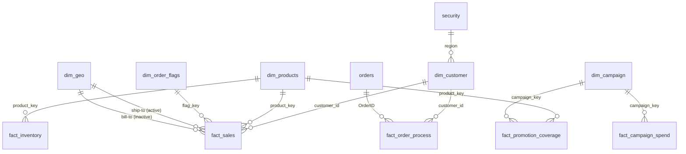

# Data_modelling_project
Data modelling is one of the most crucial step in business intelligence which helps to derive better insights and build better visulalizations.In this repo a messy excel worksheet has been cleaned and used to build a data model for further analytical purposes.

# Power BI Data Model: Cleaning a Messy Excel Dataset into a Star Schema

A Power BI **data model** (no dashboards) built from a deliberately messy, multi-sheet Excel workbook. The work is all in Power Query (cleaning, reshaping, key generation) and the model layer (star schema, relationships, a security table).

| File | What it is |
|---|---|
| `dataset.xlsx` | Raw source. 23 sheets of messy, denormalised, partly duplicated business data (orders, customers, products, shipments, invoices, payments, campaigns, inventory, targets). |
| `mywork1.pbix` | The finished model: 20 tables, 12 relationships, Power Query transformations for every table. |

---

## The problem

The source workbook has the kind of issues real exports have:

- Orders split across two yearly sheets with **different column sets** (`ORDERS_2025` carries extra `LegacyRef` / `SourceFile` columns).
- Customer attributes scattered over five sheets: `CUST_MASTER`, `customer_contacts` (several contacts per customer), `user_details` (keyed as `UserID`), `Address`, `cities`.
- **Test and placeholder records** mixed into master data (customer `9999`, product `ZZZ-000`, two `SAP-0990xx` rows, a `TEST` subcategory).
- **Wide, pivoted data**: `inventory` has one column per month.
- **Delimited lists in a cell**: `campaign_skus` stores promoted SKUs as `"HOM-044, BEA-012, ..."`.
- **Denormalised logs**: `CAMPAIGN_LOG` repeats campaign name, channel, dates and budget on every daily row.
- **Coded values** without labels: `OrderChannel` is `10/20/30/40`.
- Category and subcategory packed in one string (`electronics|phones`).
- Relationships only by **names, not keys** (orders reference `CustomerName` and `ProductName`).
- Duplicate sheets (`Sheet1` is identical to `shipments`).

## The solution: star schema

Surrogate integer keys are generated in Power Query for each dimension, and fact tables are re-pointed to those keys.

### Relationships

All are many-to-one with single-direction filtering.

| From (many) | To (one) | Key | Active |
|---|---|---|---|
| `fact_sales` | `dim_customer` | `customer_id` | Yes |
| `fact_sales` | `dim_products` | `product_key` | Yes |
| `fact_sales` | `dim_order_flags` | `flag_key` | Yes |
| `fact_sales` | `dim_geo` | `shi_to_city_key` → `geo_key` | Yes |
| `fact_sales` | `dim_geo` | `bill_to_city_key` → `geo_key` | **No** (role-playing dimension; activate with `USERELATIONSHIP`) |
| `fact_inventory` | `dim_products` | `product_key` | Yes |
| `fact_promotion_coverage` | `dim_products` | `product_key` | Yes |
| `fact_promotion_coverage` | `dim_campaign` | `campaign_key` | Yes |
| `fact_campaign_spend` | `dim_campaign` | `campaign_key` | Yes |
| `fact_order_process` | `orders` | `OrderID` | Yes |
| `fact_order_process` | `dim_customer` | `customer_id` | Yes |
| `dim_customer` | `security` | `region` → `Region` | Yes |

## Tables

### Dimensions

| Table | Rows | Built from | Notes |
|---|---|---|---|
| `dim_customer` | 60 | `CUST_MASTER` + `customer_contacts` + `user_details` + `Address` + `cities` | Test customer `9999` removed. Contact, credit limit, phone, street, city and region merged in. Columns renamed to snake_case. |
| `dim_products` | 60 | `products` + `subcategories` | Placeholder rows removed. `product_key` generated by index. Category derived from the `category\|subcategory` lookup and proper-cased. `ProductDescription` and `hash_key` dropped. |
| `dim_order_flags` | 14 | distinct `OrderChannel` × `Status` × `Priority` from `orders` | Junk dimension. Channel code (`10/20/30/40`) mapped to a readable channel name. |
| `dim_geo` | 20 | `cities` | One row per city with its region; `geo_key` by index. |
| `dim_campaign` | 6 | `CAMPAIGN_LOG` | Distinct campaign attributes (name, channel, start/end date, budget). |
| `dim_date` | 730 | `CALENDARAUTO()` | DAX calculated table, 2025-01-01 to 2026-12-31. |
| `security` | 5 | `security` sheet | User-to-region mapping for region-based row-level security. |

### Facts

| Table | Rows | Grain | Built from |
|---|---|---|---|
| `fact_sales` | 200 | One row per order line | `order_line_items` joined to order header fields; names resolved to `customer_id`, `product_key`, `flag_key`, ship-to and bill-to `geo_key`. |
| `fact_order_process` | 97 | Order lifecycle milestones | `orders` + `shipments` + `INVOICES` + `payments`: OrderDate → ShipDate → DeliveryDate → InvoiceDate → PayDate. Exceeds 80 rows because of one-to-many joins to invoices and payments. |
| `fact_inventory` | 288 | Product × month | `inventory` unpivoted (24 products × 12 months of 2025). |
| `fact_campaign_spend` | 140 | Campaign × day | `CAMPAIGN_LOG` with campaign attributes moved out to `dim_campaign`. |
| `fact_promotion_coverage` | 30 | Campaign × promoted product | `campaign_skus` split from comma-separated text to rows (bridge between campaigns and products). |
| `fact_sales_target` | 20 | Month | `sales_targets`; `Period` renamed to `date`. |

### Supporting

| Table | Purpose |
|---|---|
| `orders` | Order headers. `ORDERS_2025` and `ORDERS_2026` appended (80 unique orders, no overlap); `LegacyRef`, `GiftMessage`, `SourceFile`, `OrderNotes` removed. |
| `_measures` | Empty placeholder table for future DAX measures. |

## Transformations by technique

| Technique | Where |
|---|---|
| Append queries | `orders` |
| Merge queries (left outer joins) to add attributes and look up keys | `dim_customer`, `dim_products`, `dim_order_flags`, `fact_sales`, `fact_order_process`, `fact_inventory`, `fact_campaign_spend`, `fact_promotion_coverage` |
| Filter out test/placeholder rows | `dim_customer`, `dim_products` |
| Unpivot columns | `fact_inventory` |
| Split delimited text into rows | `fact_promotion_coverage` |
| Remove duplicates to create dimensions | `dim_order_flags`, `dim_campaign` |
| Index columns as surrogate keys | `dim_products`, `dim_order_flags`, `dim_geo`, `dim_campaign` |
| Trim text, change types, proper-case, rename, reorder, remove columns | throughout |

## Tools

Power BI Desktop · Power Query (M) · DAX · Excel
